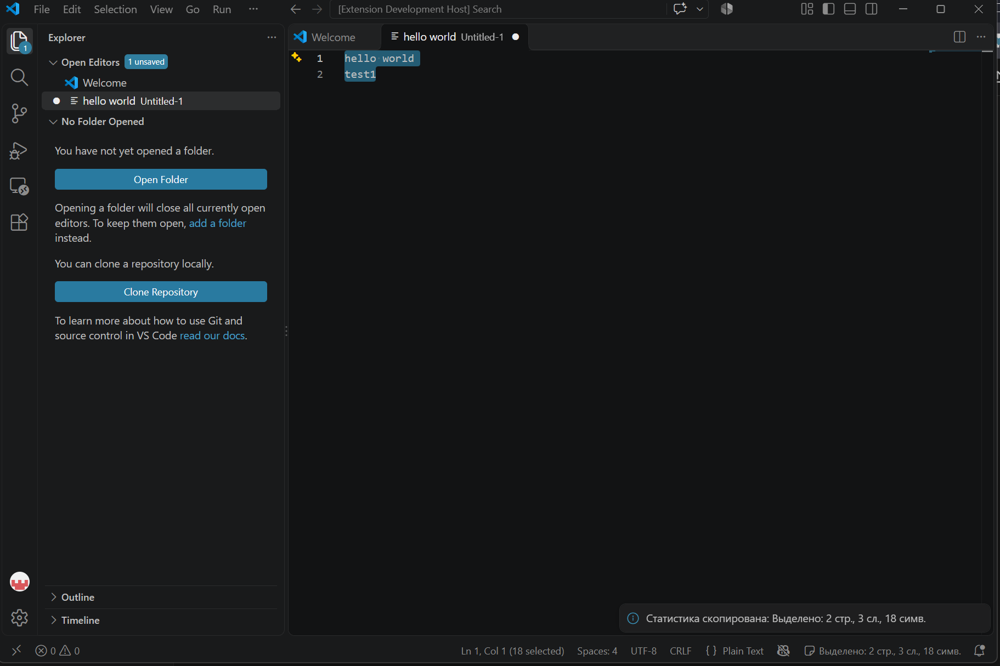

# Text Stats Bar

Автор: Жеварцов Тимофей Александрович M3112

## Описание
Плагин для VS Code, который показывает в строке состояния статистику текста
активного файла: количество строк, слов и символов.

## Возможности
- Статистика всего файла (строки, слова, символы) в правой части строки состояния.
- Если в файле что-то выделено, показывается статистика выделенного фрагмента.
- Статистика обновляется при переключении файлов, редактировании текста и изменении выделения.
- Клик по статистике (или команда **Copy Text Statistics** в палитре команд) копирует её в буфер обмена.

## Использование
1. Откройте любой текстовый файл, статистика появится справа внизу.
2. Выделите фрагмент текста, чтобы увидеть статистику выделения.
3. Нажмите на статистику или выберите **Copy Text Statistics** через Ctrl+Shift+P.

## Установка
Extensions → ... → Install from VSIX и выберите файл `.vsix`.